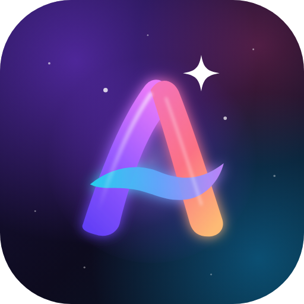

# AURA

**Android-клиент для домашнего музыкального сервера HomeMusic**

[Скачать APK](https://github.com/PlayInSpirits/AURA/releases) ·
[Возможности](#возможности) ·
[Лицензия](#лицензия)

---

AURA играет вашу музыкальную библиотеку с домашнего сервера [HomeMusic](https://github.com/justman-1/HomeMusic-public)
(Navidrome и хаб HomeMusic). Вся тяжёлая работа идёт на сервере: поиск, скачивание, рекомендации и ИИ-ассистент.
Приложение входит в аккаунт, проигрывает музыку и показывает хаб.

Основа приложения — открытый клиент Subsonic/Navidrome [Tempus](https://github.com/eddyizm/tempus).

> [!NOTE]
> Проект в стадии **бета**. Релизы публикуются как pre-release; что-то может работать не так, как задумано.

## Возможности

### 🌊 Моя волна
- Весь первый экран — живой фон волны, как в Яндекс Музыке: он уходит под прозрачную верхнюю панель и строку состояния.
- Стеклянная полупрозрачная кнопка: пауза/продолжить, если волна уже играет; новая волна — только когда играет другое.
- Остальное содержимое главной («Открытия» и подборки) ждёт ниже: потяните экран вверх — он пружинисто докрутится.

### 🔍 Поиск
- Поиск хаба прямо в приложении: каталог (исполнители, альбомы, треки), «Файлы» и «Без цензуры», история запросов.
- Страницы исполнителей и альбомов; песни из библиотеки играют сразу, остальное — одной кнопкой в загрузки хаба.

### 🎧 Плеер
- Фон из обложки: размытая обложка и её основной цвет, плавно меняются со сменой трека.
- Большая белая кнопка воспроизведения, крупная шкала, стеклянная панель с таймером, текстом, плейлистом и очередью.

### 🏠 Хаб
- Открывается отдельным окном со своей нижней панелью и кнопкой «Назад».
- «Микс дня» и «Моя волна» убраны из хаба (волна на главной), ссылка на Navidrome ведёт на домашний сервер.

### 🎨 Оформление
- Фиолетовая палитра AURA и чёрная AMOLED-тема по умолчанию, новая иконка.
- Три вкладки: Главная, Поиск, Хаб. «Выйти» — внизу настроек.

Приложение общается с HomeMusic только через HTTP API хаба
([`hub/API.md`](https://github.com/justman-1/HomeMusic-public/blob/main/hub/API.md)).

  
# Лицензия

**[GNU GPL v3](LICENSE), самоподписанный AURA.**

